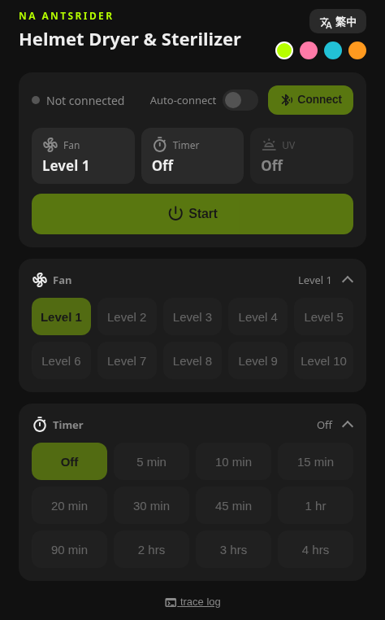

# NA ANTSRIDER Helmet Dryer & Sterilizer Controller

[繁體中文](README.md)

A replacement for the official WeChat mini-program: control your NA ANTSRIDER helmet dryer and sterilizer over Bluetooth (Web Bluetooth) straight from the browser.

**Use it online: <https://iridance.github.io/antsrider-helmet-dryer-control/>**

## Features

- Fan: off, or levels 1 to 10
- Timer: no limit, or common presets from 5 minutes to 4 hours
- UV sterilization: on or off
- Auto-connect: connects automatically when the device is nearby, on page load or after a drop (see limits below)
- Traditional Chinese / English switch
- Four theme colors (lime, pink, teal, orange)
- Remembers your usage habits: fan, timer, and UV settings are kept, and "Start" applies your last combination

## Usage

1. Use Chrome or Edge on Android or desktop. Safari and Chrome on iPhone do not support Web Bluetooth, so open the page in the [Bluefy](https://apps.apple.com/app/bluefy-web-ble-browser/id1492822055) browser from the App Store instead.
2. Disconnect the WeChat mini-program first. The device accepts only one connection at a time.
3. Open the link above, press "Connect", and choose `KTxxxxx-BLE-2.1`.

### Auto-connect limits

- You must connect manually and authorize the device once before you can turn it on.
- The browser must support the "get authorized devices" feature. If Chrome or Edge does not, enable `chrome://flags/#enable-web-bluetooth-new-permissions-backend` (`edge://flags/...` for Edge). The page shows how when it is unsupported.
- The page must stay open; it does not reconnect in the background after the tab or browser is closed.
- It cannot connect while the mini-program or another device is connected, since the device accepts only one connection at a time.

## Protocol

The device uses Bluetooth Low Energy with service `0xFFF0`. Commands are sent as write-without-response to characteristic `0xFFF1`:

| Function | Command |
| --- | --- |
| Fan 0 to 10 | `AA 01 <level>` |
| Timer (minutes, 16-bit) | `AA 02 <high byte> <low byte>` |
| UV | `AA 03 00 00 <1 on / 0 off>` |

`0xFFF2` is the notify characteristic. Data sent back by the device appears in the page's trace log.

## Run locally

A plain static page with no build step. Open `site/index.html` in Chrome, or run `python -m http.server -d site 8000` in the project folder and open `http://localhost:8000`.

## Deployment

Pushing a `v*` version tag (such as `v1.0.0`) makes GitHub Actions deploy `site/` to GitHub Pages.

## Privacy

This project collects no data: no accounts, no tracking or analytics, and nothing is sent to any server. Your settings are stored only in your own browser's local storage.

## Disclaimer

This is an unofficial project and is not affiliated with the ANTSRIDER brand. Use at your own risk.

© [Irice](https://github.com/iridance). Released under the [MIT License](LICENSE).
