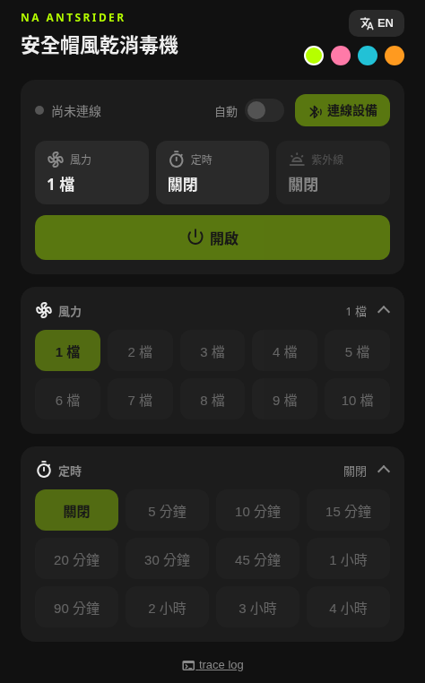

#  NA ANTSRIDER 安全帽風乾消毒機 控制器

[English](README.en.md)

取代官方微信小程序，直接用瀏覽器透過藍牙（Web Bluetooth）控制 NA ANTSRIDER 安全帽風乾消毒機。

**線上使用：<https://iridance.github.io/antsrider-helmet-dryer-control/>**

## 功能

- 風力：關閉，或 1 到 10 檔
- 定時：不限時，或 5 分鐘到 4 小時的常用選項
- 紫外線殺菌：開／關
- 自動連線：開啟頁面或斷線後，設備在附近時自動連上（限制見下方）
- 繁中／English 切換
- 四種主題色（螢光綠、粉、藍綠、橘）
- 自動記住使用習慣：風力、定時、紫外線的設定會保留，按「開啟」即套用上次的組合

## 使用方式

1. 使用 Android 或電腦版的 Chrome／Edge；iPhone 的 Safari 與 Chrome 不支援 Web Bluetooth，請改用 App Store 的 [Bluefy](https://apps.apple.com/app/bluefy-web-ble-browser/id1492822055) 瀏覽器開啟。
2. 先斷開手機上微信小程序的連線，設備同一時間只接受一個連線。
3. 開啟上方網址，按「連線設備」，選擇 `KTxxxxx-BLE-2.1`。

### 自動連線的限制

- 需先手動連線一次並授權設備，之後才能啟用。
- 瀏覽器要支援「取得已授權設備」功能；Chrome／Edge 若不支援，需開啟 `chrome://flags/#enable-web-bluetooth-new-permissions-backend`（Edge 為 `edge://flags/...`）。不支援時頁面會顯示開啟方式。
- 頁面必須開著才能連線，關掉分頁或瀏覽器後不會在背景自動連上。
- 手機小程序或其他裝置連著時無法自動連上，設備同一時間只接受一個連線。

## 通訊協定

設備使用低功耗藍牙（BLE），服務為 `0xFFF0`。指令以無回應寫入的方式送到特徵值 `0xFFF1`：

| 功能 | 指令 |
| --- | --- |
| 風力 0 到 10 | `AA 01 <檔位>` |
| 定時（分鐘，16 位元） | `AA 02 <高位元組> <低位元組>` |
| 紫外線 | `AA 03 00 00 <1 開／0 關>` |

`0xFFF2` 為通知特徵值，設備回傳的資料會顯示在頁面的 trace log。

## 本機執行

純靜態頁面，不需要建置。用 Chrome 直接開啟 `site/index.html`，或在專案目錄執行 `python -m http.server -d site 8000`，再開啟 `http://localhost:8000`。

## 部署

推送 `v*` 版本 tag（例如 `v1.0.0`）後，GitHub Actions 會自動部署 `site/` 到 GitHub Pages。

## 隱私

本專案不收集任何資料：沒有帳號、沒有追蹤或分析工具，也不會把資料傳到任何伺服器。你的設定只存在自己瀏覽器的本機儲存空間。

## 聲明

本專案為非官方開發，與 ANTSRIDER 品牌無關聯，使用風險自負。

© [Irice](https://github.com/iridance)，以 [MIT 授權](LICENSE) 釋出。
